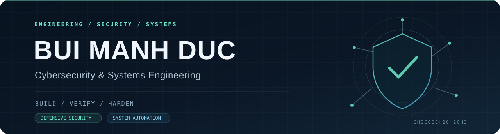

**Defensive security · Systems engineering · Infrastructure automation**

## About

I'm **Bùi Mạnh Đức**, focused on building security-conscious systems and reproducible engineering workflows.

My work connects **defensive security**, **Linux and network infrastructure**, **application engineering**, and **automation**. I care about practical design choices: clear trust boundaries, observable behavior, testable controls, and evidence that supports each claim.

> **Engineering principle:** A security control is only as convincing as the evidence that demonstrates what it does—and where it stops.

## Selected work

| Project | What it demonstrates |
| :--- | :--- |
| **[Mini SOC — Enterprise Web Lab](https://github.com/CH3COOCH2CH2CH3/mini-soc-enterprise-web-lab)** | A reproducible defensive-security lab integrating NGINX, Suricata, Wazuh, application telemetry, security rules, and evidence-based validation. The repository explicitly distinguishes verified results from work still awaiting validation. |
| **[Cybersecurity Portfolio](https://github.com/CH3COOCH2CH2CH3/Portfolio)** | A Next.js / TypeScript portfolio with a technical case study of SOC architecture, security boundaries, engineering decisions, and documented limitations. |

<b>How I approach security engineering</b>

- **Design:** identify assets, trust boundaries, attack surfaces, and failure modes.
- **Implement:** select proportionate controls across network, host, and application layers.
- **Observe:** collect structured telemetry and make system behavior inspectable.
- **Validate:** reproduce test conditions, record evidence, and distinguish measured outcomes from assumptions.
- **Improve:** document gaps, failure cases, and next steps instead of overstating readiness.

## Technical areas

| Area | Technologies and practices |
| :--- | :--- |
| **Security & monitoring** | Wazuh, Suricata, NGINX, nftables, security logging, threat modeling |
| **Infrastructure** | Linux, Docker / Compose, network configuration, CI workflows |
| **Application engineering** | TypeScript, JavaScript, React, Node.js, SQL |
| **Automation & analysis** | PowerShell, Python, Bash, reproducible test workflows |
| **Engineering practice** | Documentation, evidence traceability, validation, secure-by-design reviews |

## Research & collaboration

My portfolio documents a contribution to **“A Policy-Controlled Multi-Domain SOC: Architecture and Evidence-Based Security-Boundary Validation”**, accepted for oral presentation at **SoICT 2026**. **Acceptance is not publication**; a proceedings link will be added only when available.

This is collaborative research. My documented focus is **SOC and security engineering**; SDN implementation and core LLM development were primarily teammate-owned.

[Read the project and contribution boundaries →](https://github.com/CH3COOCH2CH2CH3/Portfolio#research-recognition)

## Explore further

- **[View the Mini SOC architecture and evidence](https://github.com/CH3COOCH2CH2CH3/mini-soc-enterprise-web-lab#architecture)**
- **[Browse the technical portfolio source](https://github.com/CH3COOCH2CH2CH3/Portfolio)**
- **[See all public repositories](https://github.com/CH3COOCH2CH2CH3?tab=repositories)**

Build carefully. Verify claims. Document limits.

